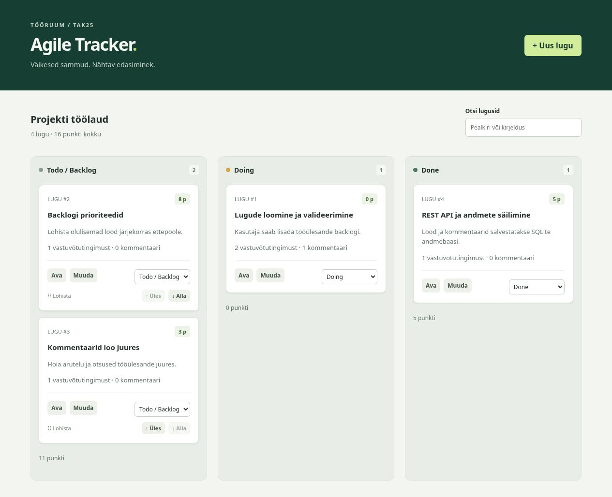

# Agile Tracker

Kohalik ühe kasutaja Kanban-rakendus kasutajalugude haldamiseks.



## Tehnoloogiad ja käivitamine

Python 3.11+, Flask, SQLite ning raamistikuvaba JavaScript, HTML ja CSS.
Node.js on vajalik ainult JavaScripti süntaksi kontrolliks, mitte rakenduse käivitamiseks.

```bash
python -m venv .venv
source .venv/bin/activate
pip install -r requirements.txt
python app.py
```

Ava <http://127.0.0.1:5055>. Andmebaas `tracker.sqlite3` tekib automaatselt.
Teise andmebaasi saab valida keskkonnamuutujaga `TRACKER_DB`:

```bash
TRACKER_DB=/tmp/tracker-demo.sqlite3 python app.py
```

Server kuulab ainult kohalikul aadressil. See on ühe kasutaja koolitöö:
autentimist ja mitme kasutaja ligipääsuhaldust pole lisatud.

## Valmis funktsioonid

- Todo / Backlog, Doing ja Done veerud; iga veeru lugude arv ja punktisumma.
- Loo loomine, muutmine, detailvaade ja kustutamine koos kinnitusega.
- ID, pealkiri, kirjeldus, täisarvulised punktid, staatus ja vähemalt üks vastuvõtutingimus.
- Punktide ja teiste väljade kontroll nii vormis kui ka API-s; null punkti on lubatud.
- Staatuse muutmine ning tekstikommentaarid koos UTC ajatempliga, mida vaade näitab kohalikus ajas.
- Backlogi järjestamine hiirega: lohista kaardi „⠿ Lohista” käepide teise kaardi peale,
  et paigutada lugu selle ette; veeru vabale alale lohistades liigub see lõppu.
- Klaviatuuriga kasutatavad „Üles” ja „Alla” nupud samaks järjestamiseks.
- SQLite salvestab lood, kommentaarid ja järjekorra; andmed säilivad taaskäivitamisel.
- Pealkirja ja kirjelduse otsing; järjestamine on otsingu ajal peidetud, et varjatud lood ei eksitaks.
- Loomise ja muutmise aeg detailvaates, kohanduv mobiilipaigutus ja tekstina kuvatav kasutajasisend.
- REST API automaattestid ja GitHub Actions kontroll.

## Pooleli / lisamata võimalused

Kohustuslike funktsioonide teadaolevaid pooleli osi ei ole. Vabatahtlikest võimalustest
on lisamata kommentaari eraldi kustutamine, eraldi staatuse/punktide filtrid ning
lugude lohistamine veergude vahel (staatust saab muuta valikust).
Puuteekraani paigutus on toetatud; päris telefoni puutežeste pole eraldi kontrollitud.

## REST API

JSON päringutel kasuta `Content-Type: application/json`.

| Meetod ja tee | Kirjeldus |
|---|---|
| `GET /api/stories` | Kõik lood prioriteedi ja ID järjekorras, koos kommentaaridega |
| `GET /api/stories/:id` | Üks lugu; puuduva ID korral 404 |
| `POST /api/stories` | Uus lugu; vastus 201 ja Location päis |
| `PUT /api/stories/:id` | Loo kõigi sisuväljade uuendamine |
| `DELETE /api/stories/:id` | Loo ja tema kommentaaride kustutamine; vastus 204 |
| `PATCH /api/stories/:id/status` | Staatus, näiteks `{"status":"doing"}` |
| `PATCH /api/stories/reorder` | Kõik backlogi ID-d soovitud järjekorras: `{"ids":[3,1,2]}` |
| `POST /api/stories/:id/comments` | Kommentaar, näiteks `{"text":"Kontrollitud."}`; vastus 201 |

Loo loomise/muutmise näide:

```json
{
  "title": "Kasutajana tahan lisada loo",
  "description": "Lugu peab ilmuma backlogi.",
  "points": 3,
  "status": "todo",
  "acceptanceCriteria": ["Vorm salvestab loo."]
}
```

`status` vaikimisi on `todo`, `description` vaikimisi tühi tekst.
`points` on kohustuslik täisarv 0–1000000; tõeväärtused ja numbrilised tekstid ei sobi.
Vigane sisend annab 400 ja JSON-kujul `error` teate. Üle 256 KiB päring annab 413.
Järjestamise päring peab sisaldama kõiki ja ainult backlogi ID-sid, ilma kordusteta.
Kui teine klient muudab backlogi, värskenda vaadet enne järjestamise kordamist.

## Kontrollimine

```bash
python -W error::ResourceWarning -m unittest -v
node --check static/board.js
```

Kaheksa API testi katavad CRUD-i, sisendivead, staatuse, ajatempliga kommentaarid,
kustutamise kaskaadi ning järjestamise terviklikkuse ja püsimise.
Päris brauseris kontrollitud: loomine, muutmine nullpunktini, staatuse muutmine,
kommentaari lisamine, hiirega ja nuppudega järjestamine ning lehe uuendamine.
Ekraanipilt on tegelikust töötavast rakendusest, eraldi ajutise näidisandmebaasiga.

## Tehniliselt keerulisemad kohad

- SQLite kontekstihaldur lõpetab tehingu, kuid ühendus tuleb eraldi sulgeda;
  kõik API ühendused suletakse `finally` plokis.
- Järjestamisel võetakse kirjutuslukk enne backlogi ID-de lugemist, kontrollitakse
  kogu ID-de hulka ning salvestatakse järjekord ühe tehinguna. Vigane päring ei muuda järjestust.
- Hiire lohistamise käepide kasutab pointer capture'i, et liikumine töötaks ka siis,
  kui pointer lahkub algselt kaardilt. Sama toiming on võimalik klaviatuurinuppudega.
- Kasutaja teksti lisatakse DOM-i `textContent` abil; seda ei tõlgendata HTML-ina.

## Arenduse jälg

Iga tööetapp algas issue'st ja eraldi selle ID-ga algavast branch'ist.
Väikesed commitid avaldati kohe. Issue'd #1, #3, #5, #7 ja #9 ning nende PR-id
näitavad tegelikku töö edenemist; ajalugu ega varasemaid tööetappe pole tagantjärele loodud.
